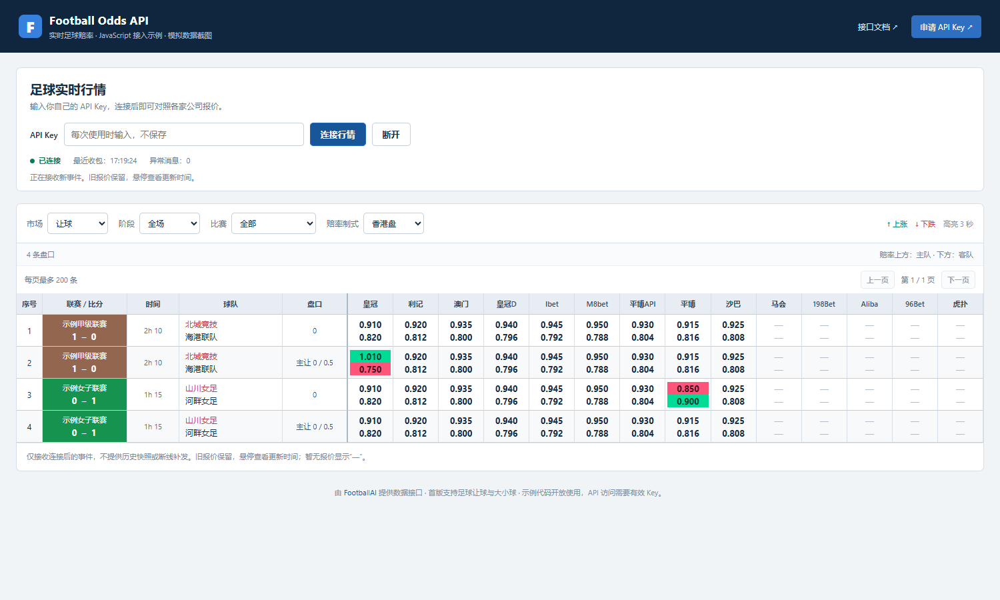

# Football Odds API — 实时足球赔率 JavaScript 示例

**FootballAI 的开源 API 接入示例。** 使用原生 HTML、CSS 和 JavaScript，通过 WebSocket 接收足球赔率，对照多家公司在同一场比赛、同一盘口下的报价。

**[申请 API Key](https://www.footballai.shop/) · [接口文档](https://www.footballai.shop/public/keys/api)**

> [!IMPORTANT]
> **🎁 新用户专属优惠：使用推广码享 API Key 8 折**
>
> | 推广码 | 优惠 | 类型 |
> | :--- | :--- | :--- |
> | **`CPGPE9EE`** | **8 折** | 折扣券 |
>
> [立即前往 FootballAI 申请 API Key](https://www.footballai.shop/)

无需安装依赖，无需构建，无需自建后端。下载代码，打开页面，输入你自己的有效 API Key 即可连接。

> English: A vanilla JavaScript example for the FootballAI football odds API. Compare live bookmaker odds through WebSocket, with Asian handicap, over/under, Hong Kong odds and Malay odds. Download the repository, open index.html, enter your own API key and connect.

*截图使用模拟数据，仅展示页面效果，不代表实时比赛、真实报价或数据覆盖承诺。*

## 功能

- **多公司实时赔率对照**：按比赛、比赛类型、结算阶段、市场、盘口值和让球方向匹配到同一行。
- **上下排列报价**：让球上方为主队、下方为客队；大小球上方为大球、下方为小球。
- **赔率变化提示**：上涨绿色、下跌红色，约 3 秒后恢复；上下两项独立变化。
- **联赛归类**：同一联赛集中排列，联赛颜色保持稳定。
- **筛选**：让球 / 大小球、全场 / 上半场、早盘 / 滚球 / 赛前。
- **赔率制式**：香港盘 / 马来盘切换，显示接口提供的原始值。
- **自动重连**：异常断线后逐步延长重试间隔，保留已有表格，新事件到达后继续更新。
- **Key 不保存**：每次打开页面重新输入；连接后输入框清空，自动重连使用当前页面内存中的 Key。
- **窄屏横向滚动**：保留公司对照表结构，方便查看多家公司报价。

首版仅展示足球让球和大小球，暂不处理胜平负、篮球及其他运动。

## 快速开始

1. 前往 **[footballai.shop](https://www.footballai.shop/)**，按网站流程申请自己的 API Key。访问权限取决于 Key 与会员状态。
2. 下载本仓库的 ZIP 并解压，或使用 Git 下载代码。
3. 直接用现代浏览器打开 **index.html**。
4. 在页面输入 API Key，点击 **连接行情**。
5. 等待连接后的新事件，使用顶部筛选查看需要的市场和赔率制式。

打开页面不需要 Node.js、npm 或 Python。也可以把这些静态文件放在自己的静态服务器或静态站点上运行。

### 页面文件

| 文件 | 内容 |
| --- | --- |
| [index.html](index.html) | 页面入口、设置、筛选与表格 |
| [styles.css](styles.css) | 表格布局、联赛颜色及涨跌高亮 |
| [app.js](app.js) | WebSocket、事件处理、数据匹配与渲染 |
| [tests](tests) | 虚构事件、自动化验证及截图工具 |
| [验证记录](docs/verification.md) | 当前已完成验证及其边界 |

## 连接接口

~~~text
wss://footballai.shop/ws/market/realtime
~~~

浏览器原生 WebSocket 不能自定义 Authorization 请求头，因此本示例使用 api_key 查询参数，并对输入值进行 encodeURIComponent 编码。完整连接 URL 不在页面或应用日志中展示。

程序客户端可以使用接口文档中的 Authorization 请求头方式。示例代码开放不代表 API 无需鉴权。

**不要把自己的真实 Key 写进源码、README、Git 提交、截图或公开网页。** 如需发布静态示例，让每位使用者在页面输入其自己的 Key。

### Key 生命周期

- 仅用于当前页面的连接及自动重连。
- 不写入 localStorage、sessionStorage、IndexedDB、Cookie 或文件。
- 刷新、关闭或重新打开页面后重新输入。
- 连接后输入框清空；主动断开后再次连接需要重新输入。
- 不在控制台打印 Key、含 Key 的连接 URL 或原始关闭原因。
- 如果自行添加反向代理或连接日志，应对握手 URL 的查询参数做脱敏处理。

## 理解数据匹配

接口推送版本 5 的两类事件：

| 事件 | 用途 | 关联字段 |
| --- | --- | --- |
| matchInfo | 联赛、球队、比分、开赛时间与比赛进程 | game_id |
| oddsInfo | 公司、市场、阶段、盘口和赔率 | game_id |

赔率可能先于比赛信息到达。页面会先显示比赛 ID 和“待补充联赛”，收到比赛信息后补齐名称及比分。

### 同一行的条件

~~~text
game_id + game_type + period + market + line.value + line.hc
~~~

- 同一比较行内，以 **company_name** 保存每家公司的独立报价。
- 等价盘口值如 0.50 和 0.5 会合并；不同盘口线分行。
- 让球方向由 line.hc 决定：H 为主让、C 为客让；零盘统一处理。
- 大小球不使用让球方向。
- odds_id 不保证跨更新稳定，不能单独作为盘口更新键。
- 较早 sys_time 的事件不能覆盖同一键的较新数据。
- 皇冠与皇冠D、平博与平博API是独立公司，分别保留。
- 不解析 param 来猜测跨公司的统一盘口标识。

### 筛选含义

| 页面选项 | 接口字段 |
| --- | --- |
| 早盘 | game_type = early |
| 滚球 | game_type = running |
| 赛前（今日） | game_type = today |
| 全场 | period = full_time |
| 上半场 | period = first_half |
| 让球 | market = handicap |
| 大小球 | market = totals |
| 香港盘 | hk_odds |
| 马来盘 | ml_odds |

“赛前（今日）”对应 today，不表示所有未来比赛。筛选只处理本页已经收到的数据，不重建连接，也不改变服务端推送范围。

### 赔率显示与颜色

- 让球使用 home / away，大小球使用 over / under。
- 缺失、空字符串或不可用报价显示 **—**，不转换或回退成另一制式。
- 使用有效 decimal_odds 判断实际涨跌，再在当前制式下高亮。
- 这样可以避免马来盘跨正负区间时，直接比较带符号数字导致涨跌颜色反向。
- 首次报价、数值不变、切换制式和切换筛选不制造涨跌信号。
- 联赛背景色只表示分组，与赔率涨跌无关。
- 悬停公司报价可查看该项最近接收时间。

## 断线与重连

| 情况 | 页面行为 |
| --- | --- |
| 网络异常、1006、1011、1013 等暂时故障 | 自动重试，间隔约 1、2、4、8、16、30 秒，并有少量随机抖动 |
| 建连超过 15 秒 | 关闭未完成的连接，按退避策略重试 |
| 1008 | 停止自动重连，提示检查 Key、账户和会员权限 |
| 4001 | 当前账户连接被其他客户端接管，停止重试以避免相互抢占 |
| 点击断开 | 停止重试，保留已收到的表格 |
| 重连成功 | 保留旧数据，收到新事件时更新对应报价 |

同一页面只维持一条有效连接和一个当前建连或重试定时器。关闭旧连接后到达的旧回调不会覆盖新连接状态。

### 数据完整性限制

**服务端没有历史快照，也不保证断线补发。**

- 首次连接后需要等待新事件，页面不会立即拥有全部盘口。
- 重连成功不代表已经补齐断线期间的数据。
- 保留的旧报价可能陈旧；不能把所有显示值视为刚刚更新的报价。
- 未提供明确的撤盘或完赛事件时，页面不会仅凭长时间无更新就删除盘口或判定完赛。
- 开赛时间来自未附时区的原始文本，页面不擅自转换。
- 本示例不承诺特定延迟、可用率、完整覆盖或历史数据能力。

## 常见问题

### 页面容量

本示例用于浏览器接入演示，最多缓存 2000 场比赛信息、2000 条比较行、32 家公司和 10000 项公司报价，每页最多显示 200 条盘口。达到任一缓存上限后，会显示提示并停止收录对应的新项；已有报价继续更新，断线重连不清空缓存。需要重新收集时可刷新页面并重新输入 Key。消息文本超过 65536 个字符时跳过并计入异常数。

这些是浏览器示例的保护上限，不代表服务端的数据覆盖范围或 API 配额。持续高流量或长期历史存储应由使用者在自己的服务端实现；本示例没有验证长期运行的性能。

### 已连接但没有数据？

接口仅推送连接后收到的事件。先等待新数据，并检查当前市场、阶段和比赛筛选。浏览器显示“已连接”只证明连接已建立。

### 某家公司或某种赔率制式为空？

该公司可能尚未推送当前盘口，或接口未提供所选香港盘 / 马来盘值。页面用“—”表示，不伪造报价。

### 同一比赛为什么出现多行？

可能有不同盘口值、让球方向、比赛类型或结算阶段。只有匹配条件一致的数据才会合并。

### 为什么另一页面连接后，本页停止重连？

服务端可能以新连接接管同一账户的旧连接，使用关闭码 4001。页面停止自动重试，避免多个客户端反复抢占。

### 刷新后为什么需要重新输入 Key？

这是有意的行为。页面不持久化凭据，也不会在刷新后自动恢复连接。

## 开发与测试

终端测试不影响普通使用者直接打开 HTML。

需要 Node.js 的数据与连接测试：

~~~sh
node --test tests/market.test.cjs tests/connection.test.cjs
node --check app.js
~~~

浏览器测试额外使用 Playwright，仅作为开发验证工具：

~~~sh
npm install --no-save --package-lock=false playwright
npx playwright install chromium
node --test tests/page.test.cjs
node tests/capture-demo.cjs
~~~

也可以通过 PLAYWRIGHT_BROWSER_EXECUTABLE 环境变量指定本机兼容的 Chromium 浏览器。测试只使用虚构事件和明确的测试 Key，不访问真实鉴权接口。

- [桌面演示截图](docs/images/football-odds-demo.png)
- [窄屏演示截图](docs/images/football-odds-mobile.png)

## 许可

示例代码使用 [MIT License](LICENSE)。

MIT 许可只适用于本仓库示例代码，不授予 FootballAI 服务端代码、API 访问权限或数据再分发权。接口和数据的使用以服务提供方授予的权限及条款为准。

**开始接入：[前往 FootballAI 申请 API Key](https://www.footballai.shop/)。**
